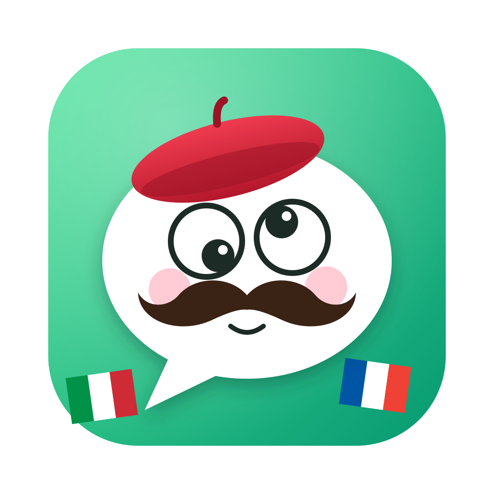

# WhatsApp Translate for Codex



A WhatsApp client for your Mac that translates your chats automatically, powered by the **[OpenAI Codex CLI](https://github.com/openai/codex)**.

> **Requires Codex.** Translations run through the Codex CLI and use your ChatGPT account. Without Codex, the client still works for chatting but can't translate.

## Download

Get the latest `WhatsApp Translate.zip` from **[Releases](../../releases/latest)** (Apple Silicon Macs).

1. Unzip it.
2. Double-click **Setup Codex.command**. macOS blocks it the first time because the app isn't notarized: click **Done**, then go to **System Settings → Privacy & Security** and click **Open Anyway**. The script then:
   - installs the Codex CLI if you don't have it (OpenAI's official installer, no admin rights needed);
   - opens your browser so you can sign in with your ChatGPT account;
   - unblocks and opens the app, then closes itself.
3. Scan the QR code with your phone: **WhatsApp → Settings → Linked devices → Link a device**.

## Features

- WhatsApp login by QR code. The session persists, and the client reconnects on its own.
- Chat list with search, unread counts, groups and contacts. Full history is synced from your phone.
- Messages: text, photos, videos, voice notes and documents, stickers, replies, reactions, edits and deletions, and delivery and read ticks.
- Sending text and files, including replies.
- Everything is stored on your Mac: the chats in SQLite, the photos and files as files.

### Translation (per chat)

Translation turns on automatically the first time you open a chat, using **GPT-6-Luna**, **Italian** (mine) and **French** (theirs). You can change any of these per chat, or switch **🌐 Translate** off, in the chat's header:

- **Model**: any model your Codex install lists (`codex debug models`).
- **Mine**: your language. Incoming messages get a translation into it, shown below each message.
- **Theirs**: the contact's language. What you type is translated into it.

When you press Enter, the translation of your draft shows up as a preview under your original text. You can edit it, then click **Send translation**, or **Send original**. The contact receives the translated text. Your original stays saved locally and appears under the sent message.

Each message is sent to the model together with the 3 messages before it, so it can resolve references, pronouns and tone. Only the message itself is translated. Translations are batched and cached, so a chat with many messages costs a single Codex run, and nothing gets translated twice.

## Privacy

- Your chats, photos and files are stored only on your Mac, in `~/Library/Application Support/WhatsApp Translate/` (or `data/` when run from source).
- Messages in chats with translation on are sent to OpenAI through Codex, together with the 3 messages before each one. Switch **🌐 Translate** off in a chat to keep it entirely local.
- Linking a different WhatsApp account deletes the previous account's local chats, so two accounts never mix.
- The local server listens on `127.0.0.1` only.

## Run from source

Requirements: Node.js 22.5 or newer (it uses the built-in `node:sqlite`), and the [Codex CLI](https://github.com/openai/codex), signed in (`codex login`).

```bash
npm install
npm start
```

Open http://localhost:3210 and scan the QR code. Or run it as the desktop app:

```bash
npm run app
```

## Build the Mac app

```bash
npm run dist
```

This builds `dist/WhatsApp Translate/`, ready to zip:

- `WhatsApp Translate.app`: the desktop app (Electron), Apple Silicon by default. Use `npm run dist -- --arch=x64` for Intel Macs or `--arch=universal` for both.
- `Setup Codex.command`: installs and signs in to Codex, unblocks the app, and closes itself.
- `READ ME FIRST.txt`: setup steps for the people you share it with.

The app is ad-hoc signed, not notarized (that needs an Apple Developer ID), so macOS blocks the setup script until the user clicks **Open Anyway** in System Settings → Privacy & Security (right-click → Open no longer works on macOS 15+). The script then unblocks the app. The app writes a log to `~/Library/Logs/WhatsApp Translate/`. Run `npm run icon` to regenerate the icon from `build/icon.svg`.

## Notes

- Codex runs with `--ignore-user-config` (so your MCP servers aren't loaded), at low reasoning effort, in a read-only sandbox and an empty working directory. The prompt treats messages as untrusted text.
- This client uses [Baileys](https://github.com/WhiskeySockets/Baileys), an unofficial WhatsApp Web protocol library. WhatsApp doesn't officially support third-party clients, so use it at your own risk.
- Environment variables: `PORT` (default 3210), `WA_DATA_DIR` (default `./data`), `TRANSLATE_MODEL` (default `gpt-6-luna`), `MY_LANGUAGE` (default Italian), `THEIR_LANGUAGE` (default French), `CODEX_BIN`, `WA_LOG_LEVEL`.
- Not affiliated with, endorsed by, or sponsored by WhatsApp, Meta or OpenAI.
